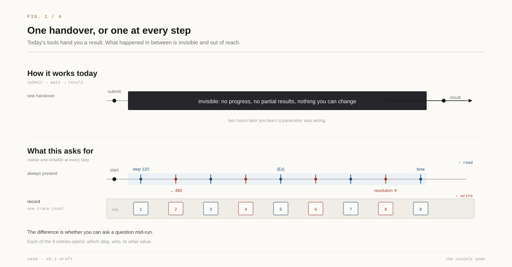
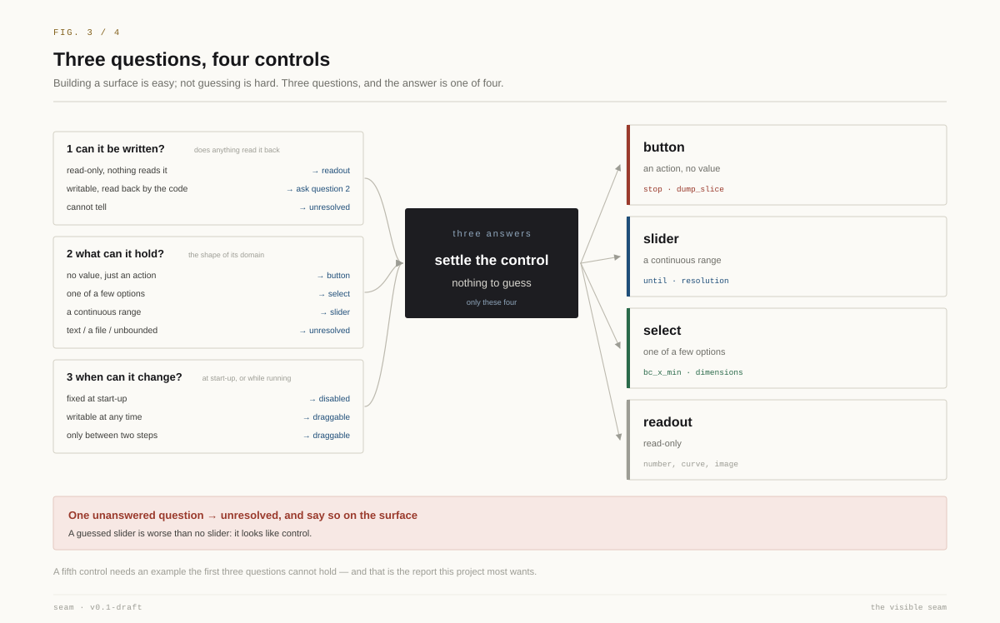
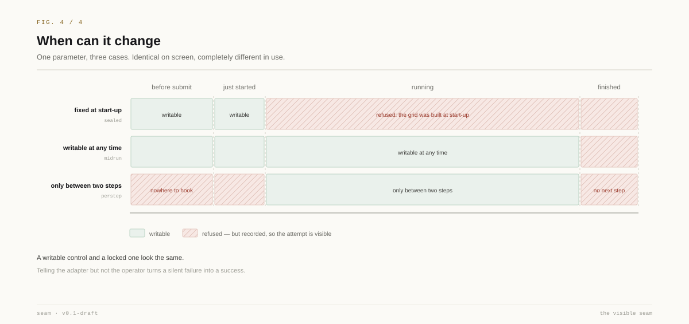
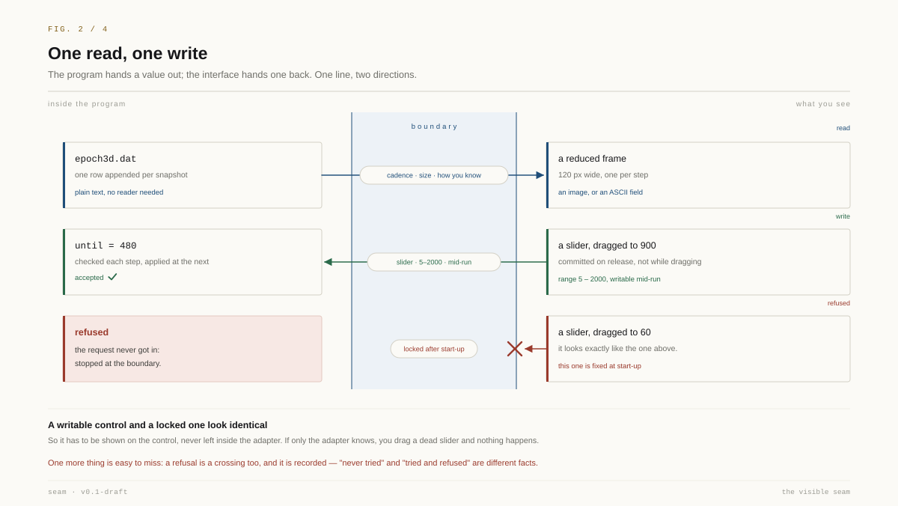

# Seam

**The visible seam between agents and simulations.**

<sub>**中文**: [README.zh-CN.md](README.zh-CN.md)</sub>

A specification for one thing: before a simulation can be driven by a person or an agent, the
program has to say what each parameter is — whether it can be written, what values it accepts,
and when a write takes effect. Say that once, and both the interface and the agent's tool
signature can be generated from it.

`v0.1-draft` · `CC-BY-4.0` · measured against four real codes



---

## The problem

You ask an agent to run a simulation. It submits the job, waits two hours, and reports back with
a result.

During those two hours you cannot see which step it reached, a wrong parameter means killing the
run, and extending the end time mid-flight has nowhere to go.

The information exists inside the program the whole time: step, time, energy, field. What is
missing is an agreed place where it can be read, and written.

## The claim: a widget is computed

Choosing a slider or a dropdown is usually treated as taste. It is a consequence of three facts:
writeability, domain shape, liveness. Write those down and the widget has one possible form.

Of the 34 writable parameters across four codes, 26 cannot change after start-up:

| | Writable | Fixed after start-up |
| :--- | :--- | :--- |
| Meep (electromagnetics) | 10 | 6 |
| EPOCH3D (plasma) | 8 | 7 |
| Gadget-2 (gravity, N-body) | 8 | 7 |
| AstroNbodySim (stellar dynamics) | 8 | 6 |

Without the declaration, those 26 are drawn as sliders anyway: they move, and nothing happens.

## The manifest: five fields

One file. Two real entries from the reference implementation:

```toml
[[param]]
name = "until"                       # end time
affordance = "dial"                  # → a slider
domain = { kind = "continuous", lo = 5, hi = 2000, step = 5 }
liveness = "perstep"                 # writable mid-run, taking effect at a step boundary
provenance = { grade = "E4", witness = "run:meep-extend-01" }

[[observe]]
name = "step"
shape = "scalar"
pitch = "per-step"                   # one per step
source = "stdout:SEAM"
provenance = { grade = "E1", witness = "python:meep.Simulation.dt" }
```

Each field answers one question:

| Field | Question |
| :--- | :--- |
| `name` | What is it called |
| `affordance` | What is it drawn as |
| `domain` | What values does it accept |
| `liveness` | When can it be written |
| `provenance` | How do you know |

The interface reads this file. The agent's tool signature is generated from the same file.

## What it is drawn as: `affordance`

| Control | Used when | On screen | Example |
| :--- | :--- | :--- | :--- |
| button | an action, no value | a button | `stop` |
| slider | a continuous value in a range | a slider with bounds | `until` ∈ [5, 2000] |
| select | a few options | dropdown or segmented | boundary `open` / `pml` |
| readout | the program produces it | number, curve, image | `step`, `ez_max` |

Three properties decide which: whether the program reads the value back, what shape its domain
has, and when it is read. Once those are written down, one control remains.



When the answer is unavailable, the point is declared `unresolved` and rendered as a line of text
with a reason.

## When it can be written: `liveness`

| Value | Meaning | On screen |
| :--- | :--- | :--- |
| `sealed` | read once at start-up | disabled, with the reason |
| `perstep` | read at each step boundary | draggable; applies at the next boundary |
| `midrun` | read whenever | draggable; applies immediately |

All three can look identical and behave completely differently, which is why this value has to be
shown on the control: if only the adapter knows, an operator drags a dead slider and concludes the
code is broken.



## How you know: `provenance`

"This parameter can be changed mid-run" is a claim. Whether to believe it depends on where it came
from:

| Grade | Source | Sufficient for liveness? |
| :--- | :--- | :--- |
| E0 | the author declared it, with a reason | yes |
| E1 | read from the code: signature, grammar, reader | no |
| E2 | copied from documentation | no |
| E3 | inferred from the name | no |
| E4 | measured: written, and the next sample changed | yes |

Only E0 and E4 count. `resolution` sounds like a knob; in Meep the grid is built from it at
construction, and writing it later changes nothing.

## One read, one write



Outward is a read: the program hands over a value, the interface draws it. What it hands over is a
reduction the program itself performed. The array is too large to cross whole, and the
reduction has to be the same for every viewer, so the program declares its width once.

Inward is a write: the interface hands back a new value, and the program picks it up at its next
check. One gesture is one submission; the intermediate values of a drag are dropped.

A refusal counts too. Write a `sealed` parameter and the request stops at the seam, never reaching
the program — and the refusal is recorded, because "never tried" and "tried and refused" are
different facts.

## Three modes

| | Job running? | Use |
| :--- | :--- | :--- |
| bench | no | edit a declaration and watch the surface re-derive, to see what the manifest produces |
| scenario | yes | step through with assertions; stop at the first one that fails |
| specimen | no | a recorded run, replayed offline, with no job and no account |

## Four real codes

| Code | Exposure | Result |
| :--- | :--- | :--- |
| Meep 1.33 | Python object | `until` extended 200 → 480 mid-run and the run reached 480; a write to a sealed parameter refused and traced |
| EPOCH3D | text deck | 7 of 8 parameters fixed at start-up |
| Gadget-2.0.7 | `tag value` paramfile | time is in Gyr (1 unit = 0.9778 Gyr); one energy column is silently zero without a compile flag |
| AstroNbodySim.jl | Julia struct | the code already exposes a per-step callback, so no probe was needed |

## Running it

```bash
git clone https://github.com/islent/seam.git          # text only
git clone https://github.com/islent/seam-examples.git # manifests/ and the seam command
cd seam-examples && pip install -e .

seam check manifests/meep.toml
seam derive --kind deck --path input.deck
seam run manifests/meep.toml --host user@gpu
```

The interface talks to a process on your machine, which holds the ssh credentials and the job
handle. The trace stays local.

## Layout

```
SPEC.md          normative text
PARADIGM.md      the fifteen words, and the sentences they enable
primitives/      the four definitions in full: observation, intervention, record, affordance
derivation/      evidence grades, the decision table, probe recipes per language
modes/           the contract behind each of the three modes
mappings/        how four real codes were fitted to the primitives
agent/           the procedure an agent follows
bindings.md      surfaces may change; their verdicts may not
assets/figures/  four figures, in both languages, from build_figures.py
```

The reference implementation — manifests, adapters, two surfaces, four experiments — is a
separate repository: [seam-examples](https://github.com/islent/seam-examples).

## Scope

- **No interface code.** Surfaces live in the examples repository: two shipped, four kept as
  experiments.
- **No scheduler.** Submission, queueing and retries belong to Slurm or its equivalent.
- **No tool protocol.** MCP and its relatives are used as they are.

## Status

A draft, implementable, and implemented against four real codes. Known gaps are in
[CHANGELOG.md](CHANGELOG.md): one sampling cadence has no home, and one experimental binding is
verified only down to the data layer.

Normative text: [SPEC.md](SPEC.md). How to settle a control for an unfamiliar code:
[docs/zh/derive.md](docs/zh/derive.md).

## License

Specification text CC-BY-4.0; reference implementation MIT.
