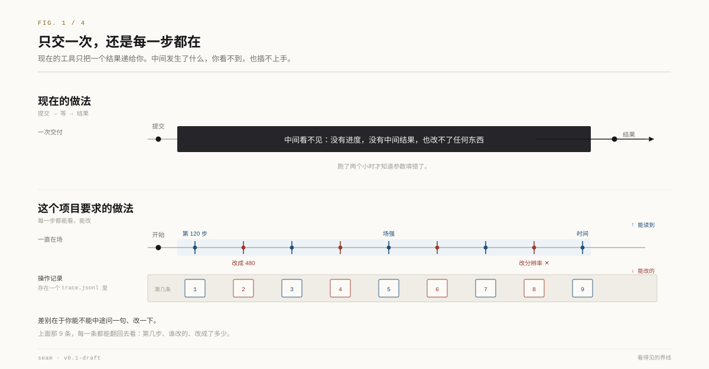
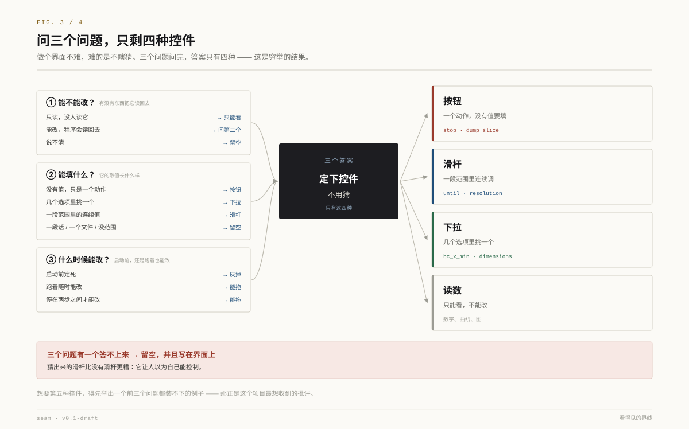
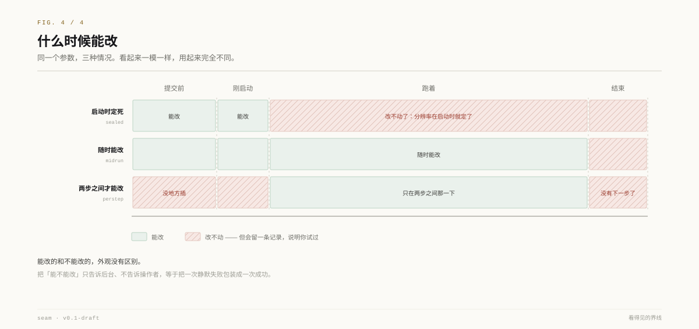
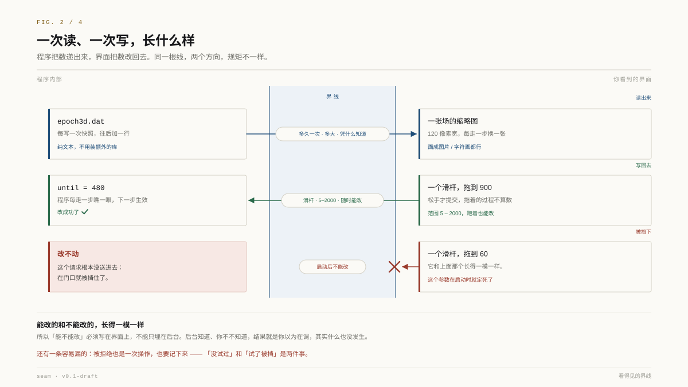

# 缝 · Seam

**让 AI 替你跑仿真的时候，你还看得见它在干什么。**

一份界面规范。仿真程序在被人或 AI 操作之前，先把每个参数讲清楚：能不能改、能填什么、什么时候能改。
讲清楚了，界面和 AI 接口都从这份说明生成，两边不会对不上。

`v0.1 草案` · `CC-BY-4.0` · 四个真实程序实测



---

## 问题

你让 AI 跑一次模拟。它提交作业、等两小时，回来说「跑完了，结果在这里」。

这两小时里：你不知道它跑到第几步；发现参数填错了，只能杀掉重来；想把结束时间调长一点，没有办法。

程序里其实一直有这些信息：第几步、多少时间、能量、场。缺的是一个说好的地方，能被读到、能被改。

## 主张：控件是算出来的

给一个参数配滑杆还是配下拉框，通常当成品味。它是三个事实的推论：能不能改、能填什么、什么时候能改。
三个事实写清楚，控件只剩一种画法。

四个代码一共 34 个能写的参数，其中 26 个在启动后就动不了了：

| | 能写的参数 | 启动后改不动 |
| :--- | :--- | :--- |
| Meep（电磁场） | 10 | 6 |
| EPOCH3D（等离子体） | 8 | 7 |
| Gadget-2（引力 N 体） | 8 | 7 |
| AstroNbodySim（天体力学） | 8 | 6 |

没有这份说明的时候，这 26 个参数一样会被画成滑杆：拖得动，什么也不发生。

## 一份清单，五个字段

规范要求的东西只有一份文件。下面是参考实现里 Meep 的两个真实条目：

```toml
[[param]]
name = "until"                       # 结束时间
affordance = "dial"                  # 画成滑杆
domain = { kind = "continuous", lo = 5, hi = 2000, step = 5 }
liveness = "perstep"                 # 跑着能改，在两步之间生效
provenance = { grade = "E4", witness = "run:meep-extend-01" }

[[observe]]
name = "step"                        # 第几步
shape = "scalar"
pitch = "per-step"                   # 每步一个
source = "stdout:SEAM"
provenance = { grade = "E1", witness = "python:meep.Simulation.dt" }
```

五个字段，各回答一个问题：

| 字段 | 回答 |
| :--- | :--- |
| `name` | 这叫什么 |
| `affordance` | 画成什么 |
| `domain` | 能填什么 |
| `liveness` | 什么时候能改 |
| `provenance` | 凭什么这么认为 |

界面读这份文件，AI 接口也读这份文件。

## 画成什么：`affordance`

| 控件 | 什么时候用 | 界面上 | 例子 |
| :--- | :--- | :--- | :--- |
| 按钮 | 一个动作，没有值 | 一个按钮 | `stop` |
| 滑杆 | 一段范围里的连续值 | 滑杆，带上下界 | `until` ∈ [5, 2000] |
| 下拉 | 几个选项里挑一个 | 下拉框或分段按钮 | 边界条件 `open` / `pml` |
| 读数 | 程序往外给，只能读 | 数字、曲线、图 | `step`、`ez_max` |

一个值落进哪一格，由三件事决定：程序会不会把它读回去、它的取值长什么样、它在什么时候被读。
三件事写完，控件只剩一种画法。



判不出来的写成 `unresolved`，界面上显示成一行带说明的文字。

## 什么时候能改：`liveness`

| 写法 | 意思 | 界面上 |
| :--- | :--- | :--- |
| `sealed` | 启动时读一次，之后不看 | 灰掉，并写明原因 |
| `perstep` | 每走一步从通道读一次 | 能拖，到下一个安全点生效 |
| `midrun` | 随时读 | 能拖，立刻生效 |

三种情况在屏幕上可以长得完全一样，行为完全不同。所以这一条必须写在控件上：只让后台知道，
操作者就会对着一个灰控件使劲拖。



## 凭什么这么认为：`provenance`

「这个参数能中途改」是一句话。判断它可不可信，看它是怎么来的：

| 级别 | 来源 | 能用来定「什么时候能改」吗 |
| :--- | :--- | :--- |
| E0 | 作者写在清单里，并说明了理由 | 能 |
| E1 | 从代码里读出来：函数签名、配置文法 | 不能 |
| E2 | 从文档里抄的：docstring、`--help` | 不能 |
| E3 | 看名字猜的：`_steps`、`dt`、`_max` | 不能 |
| E4 | 真跑一次：写进去，看下一次采样变没变 | 能 |

只认 E0 和 E4。`resolution` 听起来像个旋钮，但在 Meep 里它在启动时就把网格建好了，
之后怎么改都不影响任何东西。

## 一次读、一次写



往右是读：程序把数递出来，界面画成图。递出来的是程序自己压好的缩略图，压到多宽写在清单里 ——
原始数组太大，而且不该由每个界面自己决定怎么缩。

往左是写：界面把新值递回去，程序在下一次检查的地方读到它。松手才算一次提交，拖动途中的值丢掉。

被挡住也算一次。写一个 `sealed` 的参数，请求在门口就被拒绝，到不了程序里；这条拒绝照样记一笔。

## 三种用法

| | 作业要跑吗 | 用来做什么 |
| :--- | :--- | :--- |
| 试验台 | 不用 | 改一个参数设定，界面立刻跟着变，用来看这份清单会生成什么 |
| 教程 | 要 | 一步步跑，每步都检查；检查不过就停下 |
| 录像 | 不用 | 把一次真实运行存下来，随时重放，不联网、不要账号 |

## 四个真程序，跑出来的结果

| 程序 | 怎么操作的 | 结果 |
| :--- | :--- | :--- |
| Meep 1.33 | Python 对象 | 跑到一半把结束时间从 200 改到 480，真的跑到了 480；写锁死的参数被拒绝，记录里留了痕 |
| EPOCH3D | 文本配置文件 | 8 个参数里 7 个启动时定死 |
| Gadget-2.0.7 | `标签 值` 参数文件 | 时间单位是 Gyr（1 单位 = 0.9778 Gyr）；某个能量列在缺少编译选项时静默输出 0 |
| AstroNbodySim.jl | Julia 结构体 | 程序自带每步回调，可以直接挂钩子 |

## 跑起来

```bash
git clone <规范仓库>        # 只有文字
git clone <参考实现仓库>     # manifests/ 和 seam 命令在这里
cd seam-examples && pip install -e .

seam check manifests/meep.toml                 # 检查一份清单
seam derive --kind deck --path input.deck      # 从真实配置文件反推清单
seam run manifests/meep.toml --host user@gpu   # 起一个作业并盯住它
```

界面连的是你电脑上的一个进程，那个进程拿着 ssh 账号和作业号去跟集群打交道。记录存在本地。

## 目录

```
SPEC.md          规范正文（英文）
PARADIGM.md      十五个词，每个词撑起一句话
primitives/      四个概念的完整定义：观测点、干预点、操作记录、四种控件
derivation/      证据分级、决策表、各语言的探针写法
modes/           三种用法各自的契约
mappings/        四个真实程序怎么套进来
agent/           给 AI 的操作流程
bindings.md      界面可以换，结论不能换
assets/figures/  四张图，中英各一套，由 build_figures.py 生成
```

## 范围

- **不写界面。** 界面在[另一个仓库](https://github.com/islent/seam-examples)：两种正式提供，四种留作实验。
- **不管调度。** 提交、排队、重试，交给 Slurm 一类工具。
- **不定义 AI 工具协议。** MCP 那一层照旧用。

## 状态

草案，可以照着实现，已在四个真实程序上跑过。已知的坑写在 [CHANGELOG.md](CHANGELOG.md)：
采样节奏缺一种、有一个实验界面只验证到数据层，没验证到像素。

怎么给一个陌生程序的参数定控件，见 [docs/zh/derive.md](docs/zh/derive.md)。

## 许可

规范文本 CC-BY-4.0，参考实现 MIT。
